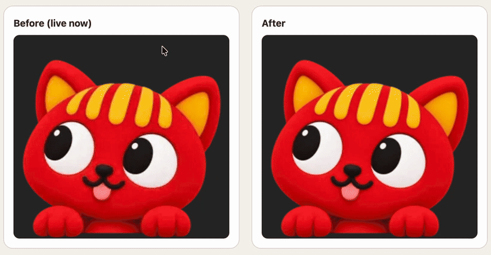

# rive-rigging-components



*Left: the ear turned as a rigid cut-out. Right: the ear bent from its base, the fix the skill now recommends (see R11 in `references/rigging.md`).*

A Claude Code skill for diagnosing Rive (`.riv`) rigging and nested-component problems: bones and mesh binding, weights, IK, joysticks, Components, events and inputs, view models and data binding, Hug/Fill, `Fit.Layout`, and runtime differences across rive-wasm, rive-react, rive-react-native, rive-flutter, rive-android and rive-ios.

Knowledge is current as of November 2026. Some editor version numbers come from a release-note mirror and are flagged as unverified inside the skill.

## Install

```bash
git clone https://github.com/rogergmg/rive-rigging-components.git
cp -R rive-rigging-components/rive-rigging-components ~/.claude/skills/
```

Start a new Claude Code session afterwards so the skill is picked up.

## License

MIT, see [LICENSE](LICENSE).
